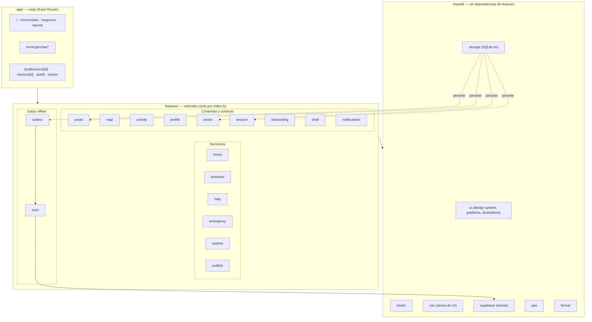
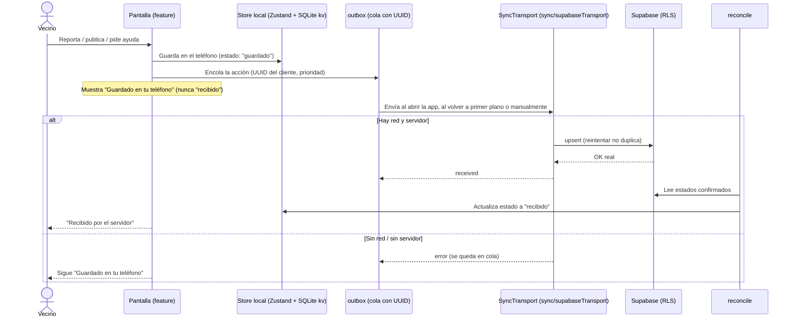
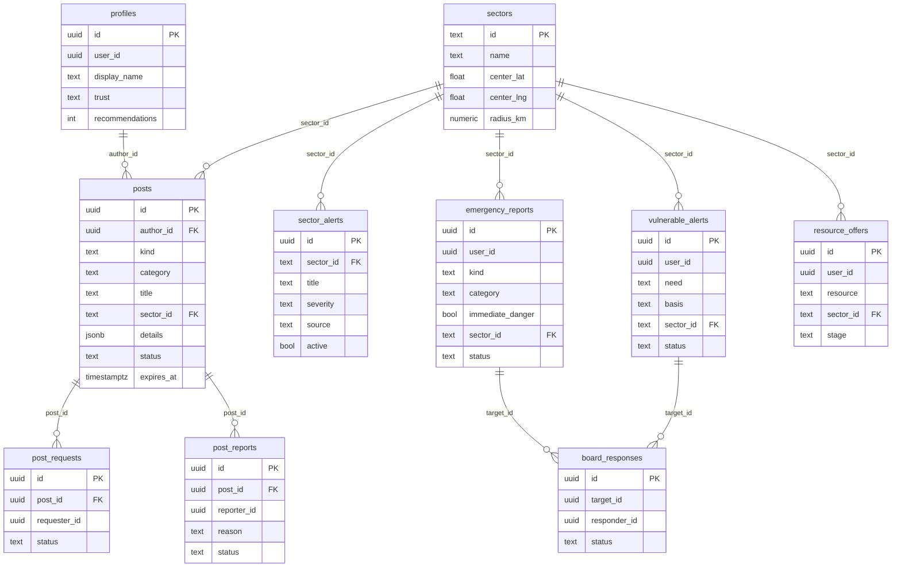
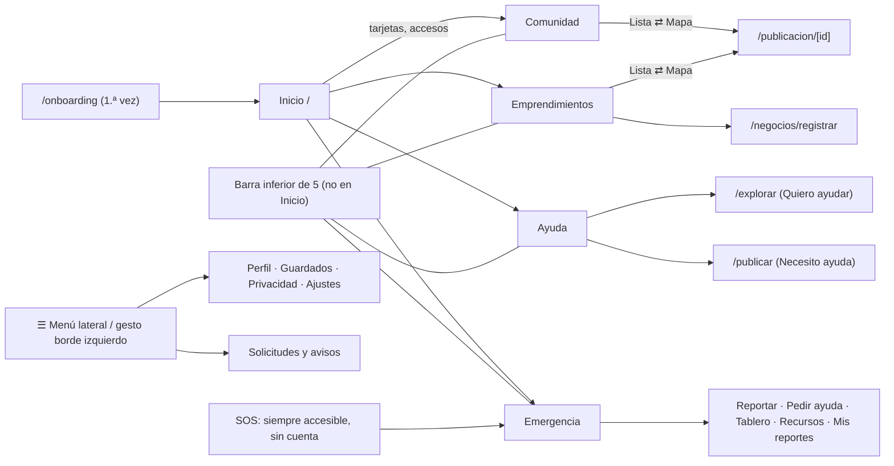

# Yunta

**Tu comunidad, más cerca.** Aplicación **solo para celular** (Android e iOS) que conecta a vecinos para resolver
necesidades del día a día — prestar y pedir herramientas, comprar a emprendimientos del barrio, enterarse de lo
que pasa cerca — y para coordinar ayuda cuando hay una emergencia. Construida con Expo + React Native + TypeScript.

> Yunta coordina ayuda entre vecinos. **No reemplaza a los servicios oficiales de emergencia** ni garantiza que
> un reporte haya sido recibido. No publiques ubicaciones exactas ni datos médicos sensibles.

- [Qué hace](#qué-hace) · [Ejecutar](#ejecutar) · [Stack](#stack) · [Arquitectura](#arquitectura) ·
  [Diagramas](#diagramas) · [Estado y datos](#estado-y-persistencia) · [Pruebas y CI](#pruebas-y-ci) ·
  [Trabajar con IA](#trabajar-con-ia) · [Deuda técnica](#deuda-técnica-y-próximos-pasos)

## Qué hace

La app tiene **Inicio** y cuatro secciones, cada una con una función principal:

| Sección | Para qué sirve | Ruta |
|---|---|---|
| **Inicio** | Puerta de entrada: buscador, qué puedes hacer, novedades, emprendimientos con foto, préstamos y recomendaciones | `/` |
| **Comunidad** | Novedades del barrio en lista o **mapa** (ofertas, pedidos, negocios, avisos) | `/comunidad` |
| **Emprendimientos** | Negocios y oficios del barrio (lista/mapa), con registro gratuito de tu negocio | `/negocios` |
| **Ayuda** | Pedir u ofrecer ayuda entre vecinos (herramientas, favores, trueque) y avisar por un vecino vulnerable | `/ayuda`, `/explorar`, `/publicar` |
| **Emergencia** | Reportar un incidente o pedir auxilio **sin cuenta**, números oficiales, tablero de coordinación y mapa | `/emergencias/*` |

Transversales: menú lateral con perfil (icono ☰ o deslizar desde el borde izquierdo), campana de actividad,
cambio de sector, tutorial inicial y **recomendaciones** según lo que cada persona mira y guarda.

Principios de producto: accesibilidad por defecto, ubicación siempre **aproximada** (por sector), datos
ficticios marcados con `DemoTag`, y honestidad de estado: «guardado en tu teléfono» nunca se presenta como «recibido».

## Ejecutar

```bash
npm install
cp .env.example .env     # opcional: sin variables la app funciona con datos de demostración
npx expo start           # escanea el QR con Expo Go en tu celular (Android/iOS)
```

| Variable (`.env`) | Para qué | Obligatoria |
|---|---|---|
| `EXPO_PUBLIC_SUPABASE_URL`, `EXPO_PUBLIC_SUPABASE_ANON_KEY` | Backend real (clave **anónima**; la seguridad es RLS) | No |
| `EXPO_PUBLIC_GOOGLE_MAPS_API_KEY` | Mapas en builds nativas (en Expo Go no hace falta) | No |

Comandos útiles: `npm run check` (todo junto), `npm test`, `npm run typecheck`, `npm run lint`,
`npm run arch:check`, `npx expo-doctor`. Builds: `npx eas-cli@latest build` (ver `eas.json`).

## Stack

| Capa | Tecnología | Por qué |
|---|---|---|
| App | Expo SDK 58, React Native 0.88, React 19, TypeScript estricto | Un código para Android e iOS |
| Rutas | Expo Router (typed routes) | Rutas por archivos, `app/` delgado |
| Estilos | NativeWind v5 (Tailwind v4) + tokens en `src/global.css` | Clases + tema compartido (versiones **fijadas**, ver ADR-0004) |
| Estado local | Zustand (+ `persist`) | Stores pequeños por feature |
| Datos remotos | TanStack Query | Caché y refresco de lecturas |
| Persistencia | `expo-sqlite` (kv), `expo-secure-store` | Offline-first; secretos fuera del kv |
| Backend | Supabase (Postgres + Auth anónima + RLS) | Sin servidores propios ni datos personales |
| Mapas | `react-native-maps` (nativo) · Leaflet + OpenStreetMap (web) | Mapa nativo en el celular |
| Formularios | React Hook Form + Zod | Validación tipada |
| Pruebas | Jest (`jest-expo`) | Lógica pura rápida |

## Arquitectura

```
src/
├── app/            Rutas (Expo Router). Delgadas: re-exportan una pantalla desde `@/features/<x>`
├── features/       Una carpeta por funcionalidad: UI + estado + datos, con un `index.ts` público
│   ├── Secciones:      home · business · help · emergency (+ explore, publish, map)
│   ├── Contenido:      posts (publicaciones, relevancia, recomendaciones) · activity · profile
│   ├── Contexto:       sector · session · onboarding · shell (cabecera, barra, menú) · notifications
│   ├── Datos offline:  outbox (cola de salida) · sync (transporte Supabase + reconciliación)
│   └── dev             Galería del sistema de diseño (solo revisión)
├── shared/         Sin dependencias de features: ui (design system, degradados, ilustraciones),
│                   hooks, nav (stores de UI), storage (kv), supabase (cliente), sync (estados), geo, format
└── global.css      Tokens de diseño (Tailwind v4 @theme)
supabase/           Migraciones SQL (esquema, RLS, alertas, ofertas y tablero compartido) y semillas
docs/               Producto, UX, accesibilidad, técnico, specs (SDD) y ADR (decisiones)
scripts/            Ingesta de lugares de referencia (OpenStreetMap) y chequeos
```

### Reglas de dependencia (automatizadas)

1. `app/` → `features/` → `shared/`. **`shared/` nunca importa de `features/`.**
2. Entre features, **solo por `index.ts`**: `@/features/posts` sí, `@/features/posts/algo` no
   (ESLint `no-restricted-imports`).
3. **Sin ciclos** entre módulos (`npm run arch:check`, con `madge`).
4. `sync/` es la capa de orquestación: conoce `outbox`, `posts`, `emergency` y Supabase; solo `app/` depende de ella.

Cómo se resuelven los acoplamientos típicos sin romper las reglas: lo común sube a `shared/` (p. ej.
`gradients`, `illustrations`, `PhotoField`, `usePickPhoto`); un dato que una feature necesita de otra se
inyecta (la campana lee `shared/nav/activityBadgeStore`, que llena `ActivityBadgeSync`; la ruta de Emergencia
pasa el mapa a la pantalla como `nearbyMap`).

## Diagramas

### 1. Capas y módulos



### 2. Flujo offline-first (de la acción al «recibido»)



### 3. Modelo de datos (Supabase, RLS en todas las tablas)



> Sin columnas de ubicación precisa: solo `sector_id`. Texto privado, fotos y diagnóstico de «vecino vulnerable»
> se quedan en el teléfono. El detalle exacto de columnas y políticas está en `supabase/migrations/`.

### 4. Navegación



## Estado y persistencia

| Qué | Dónde | Notas |
|---|---|---|
| Preferencias, sector, tutorial, intereses, guardados, publicaciones propias, reportes | Zustand `persist` sobre `shared/storage/kv` (SQLite en el celular; `localStorage` solo en la vista web de desarrollo) | No secretos |
| Sesión anónima de Supabase | Mismo kv (sin datos personales) | Se crea al primer envío |
| Cola de envío | `outbox` (store persistido) | UUID del cliente = idempotencia |
| Lecturas remotas (publicaciones, tablero, alertas) | TanStack Query, `staleTime` corto | Con respaldo de datos de demo |
| Secretos/tokens | `expo-secure-store` | Nunca en el kv |

## Mapas

`CommunityMap` es **un solo componente reutilizable** que se incrusta en cada sección (`layers`, `embedded`, `height`):
Emprendimientos y Comunidad con alternador Lista ⇄ Mapa, Explorar para publicaciones y Emergencia para
incidentes y recursos. Se dibuja con `react-native-maps` (la vista web de desarrollo usa Leaflet, solo para revisar en el computador). Los marcadores son
**pines** con la punta sobre la coordenada y el icono de su capa; todos los puntos son zona aproximada.

## Recomendaciones

`recommendPosts` (`features/posts/recommend.ts`) parte de la relevancia general (`rankPosts`: cercanía,
frescura, confianza, urgencia) y suma peso a las categorías que la persona más abre o guarda
(`interestStore`, solo en su teléfono); baja lo ya visto, nunca recomienda lo propio y explica el motivo
(«Porque miras herramientas»).

## Pruebas y CI

- `npm test` — Jest (`jest-expo`), pruebas de lógica pura junto al código (`*.test.ts`): relevancia,
  recomendaciones, filtros, rubros, resolución de secciones de la barra.
- `npm run check` — typecheck + lint (incluye límites entre features) + ciclos (`madge`) + pruebas.
- GitHub Actions (`.github/workflows/ci.yml`) corre `npm run check` en cada push a `main` y en cada PR.
- Lo que no cubre una prueba (pantallas, dos dispositivos, modo avión, letra grande) se verifica a mano en Expo Go.

## Trabajar con IA

El repo está preparado para trabajar con asistentes de IA sin romper la arquitectura:

- [`CLAUDE.md`](CLAUDE.md): comandos, dónde va cada cosa, reglas de dependencia, convenciones y trampas conocidas.
- [`AGENTS.md`](AGENTS.md): reglas de Expo (las APIs cambian por SDK; consultar la doc versionada).
- **SDD + TDD** ([`sprints.md`](sprints.md)): spec corta con criterios Dado/Cuando/Entonces
  ([plantilla](docs/specs/_plantilla.md)) → prueba que falla → código mínimo → refactor → `npm run check`.
- [`docs/adr/`](docs/adr): decisiones de arquitectura (features verticales, offline-first, Supabase+RLS, NativeWind fijado).
- Las reglas son **ejecutables** (lint, madge, Jest, CI): si la IA se salta una, el chequeo falla.

## Convenciones de producto

- Accesibilidad: áreas táctiles ≥ 48 dp, `accessibilityLabel`/`Role`, estado con texto + icono, escalado de fuente.
- Todo dato ficticio muestra `DemoTag`; los estados de envío usan `SyncStatusBadge`.
- Código en inglés; textos de interfaz y documentación en español.
- Tokens de color en `src/global.css`, espejados en `src/shared/ui/theme.ts`.

## Documentación

[`PRODUCT.md`](PRODUCT.md) (producto) · [`context.md`](context.md) (contexto de la app) · [`sprints.md`](sprints.md)
(plan de sprints) · [`docs/`](docs) (brief, UX, accesibilidad, técnico) · `design/stitch/` (referencias visuales).

## Deuda técnica y próximos pasos

- Partir `features/emergency` (~3 000 líneas, 29 archivos) y `publish/PublishScreen.tsx` (~570 líneas) en subfeatures.
- Más pruebas: `buildMapPoints`, orden de la cola `outbox`, y pruebas de RLS contra una rama de Supabase (nunca producción).
- Pruebas de pantallas con React Native Testing Library para Inicio, barra y formularios.
- Notificaciones push remotas (hoy son locales) y tablero con tiempo real.
- Normalizar saltos de línea a LF en todo el repo (`.gitattributes` + `.editorconfig` ya definidos).
